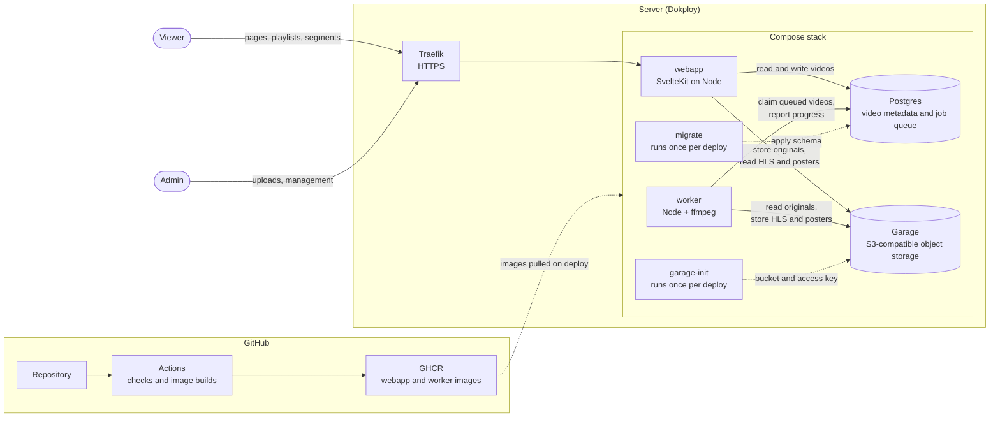
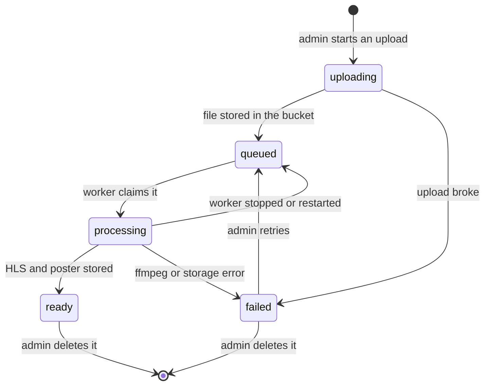
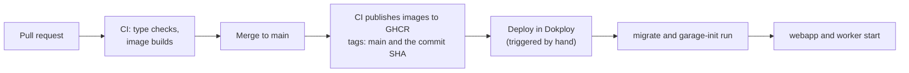

# Video Streaming Service

A self-hosted, on-demand video site. An admin uploads videos; the service converts
them to adaptive HLS in several qualities and publishes them in a catalog anyone
can watch.

Live at <https://video.andreferraz.com>.

- **Catalog and player:** the newest video is featured on the home page, the rest
  sit in a grid. The player adapts quality to the connection and lets the viewer
  pick one by hand.
- **Admin area:** upload with drag and drop, follow processing live, edit titles
  and descriptions, publish, unpublish, retry and delete.
- **Self-contained:** everything runs on one server. No third-party video,
  storage or font services are involved.

## System design



Only the web app is reachable from outside, and only through the proxy. Postgres
and Garage have no published ports. The web app and the worker never talk to each
other: they coordinate through the `status` column in Postgres and the files in
the bucket.

| Part | What it does |
|---|---|
| **webapp** | Serves every page, receives uploads and streams them into storage, and streams playlists, segments and posters back out to players. |
| **worker** | Has no web server. Polls for queued videos, transcodes each with ffmpeg and stores the result. |
| **Postgres** | One `videos` table. Its `status` column doubles as the job queue. |
| **Garage** | Holds the original uploads, the HLS output and the posters in one private bucket. Replaceable by any S3-compatible storage; see [docs/storage.md](docs/storage.md). |
| **migrate** | Applies pending database migrations, then exits. The apps wait for it. |
| **garage-init** | Gives Garage its storage role, creates the bucket and registers the access key, then exits. Skips whatever is already done. |

### The life of a video



A video in `ready` is visible only to the admin until it is published. Publishing
is a separate switch (`published_at`), not a status.

The worker produces up to four renditions, 1080p, 720p, 480p and 360p, and never
one larger than the source. Each is cut into 4-second segments that line up across
renditions, so a player can change quality at any segment boundary.

### Files in the bucket

```
sources/<video id>               the original upload
hls/<video id>/master.m3u8       the playlist that lists the renditions
hls/<video id>/720p/index.m3u8   one playlist per rendition
hls/<video id>/720p/seg_00000.ts its segments
posters/<video id>.webp          the poster, up to 1280 by 720
posters/<video id>-small.webp    the same, up to 640 by 360, for cards
```

## Repository layout

```
webapp/     SvelteKit app: catalog, player, admin area
worker/     transcoding worker
shared/     code both use: database schema, migrations, storage client
garage/     Garage configuration
compose.yaml       the whole stack, as deployed
compose.dev.yaml   local additions: publishes Postgres and Garage on localhost
.github/workflows/ci.yml   checks and image builds
```

It is a pnpm workspace. `shared` exports its TypeScript sources directly, so
neither the web app nor the worker needs a build step for it; Node runs the
worker's TypeScript as it is.

## Running it locally

You need:

- **Node 26.13.1.** `mise install` picks it up from `mise.toml`. pnpm refuses to
  run under any other version.
- **pnpm 10.33.2**
- **Docker** with Compose, for Postgres and Garage
- **ffmpeg** and **ffprobe** on your PATH, for the worker

### First-time setup

1. Create your settings file:

   ```bash
   cp .env.example .env
   ```

2. Fill in the empty values in `.env`. These commands generate suitable ones:

   ```bash
   openssl rand -hex 16               # POSTGRES_PASSWORD, also goes inside DATABASE_URL
   openssl rand -hex 32               # GARAGE_RPC_SECRET
   openssl rand -hex 32               # GARAGE_ADMIN_TOKEN
   echo "GK$(openssl rand -hex 12)"   # S3_ACCESS_KEY_ID
   openssl rand -hex 32               # S3_SECRET_ACCESS_KEY
   openssl rand -hex 32               # SESSION_SECRET
   ```

   Choose any `ADMIN_PASSWORD`, and set `ORIGIN=http://localhost:5173`.

3. Install dependencies and start Postgres and Garage:

   ```bash
   pnpm install
   pnpm stack:up
   ```

4. Prepare storage and the database:

   ```bash
   docker compose -f compose.yaml -f compose.dev.yaml run --rm garage-init
   pnpm --filter shared db:migrate
   ```

### Day to day

Run these in two terminals:

```bash
pnpm dev      # web app at http://localhost:5173
pnpm worker   # transcoding worker
```

Sign in at <http://localhost:5173/admin> with your `ADMIN_PASSWORD`, upload a
video, wait for it to become ready, and publish it.

### Commands

| Command | What it does |
|---|---|
| `pnpm dev` | Web app with hot reload |
| `pnpm worker` | Transcoding worker |
| `pnpm stack:up` | Start Postgres and Garage |
| `pnpm stack:down` | Stop them; data stays in Docker volumes |
| `pnpm check` | Type-check the web app |
| `pnpm --filter shared check` | Type-check the shared package |
| `pnpm --filter worker check` | Type-check the worker |
| `pnpm --filter shared storage:check` | Run every storage operation against the configured S3 server |
| `pnpm build` | Production build of the web app |
| `pnpm --filter shared db:generate` | Create a migration after changing the schema |
| `pnpm --filter shared db:migrate` | Apply migrations to the local database |

## Configuration

Everything is configured through environment variables: `.env` locally, the
Compose service's environment on the server.

| Variable | Used by | Meaning |
|---|---|---|
| `POSTGRES_PASSWORD` | Postgres, Compose | Password of the `videos` database user |
| `GARAGE_RPC_SECRET` | Garage | Garage's internal secret, 64 hex characters |
| `GARAGE_ADMIN_TOKEN` | Garage, garage-init | Protects Garage's admin API |
| `DATABASE_URL` | webapp, worker | Postgres connection string. Local only: on the server Compose builds it |
| `S3_ENDPOINT`, `S3_REGION`, `S3_BUCKET` | webapp, worker | Where the bucket is. Local only: on the server Compose supplies them |
| `S3_FORCE_PATH_STYLE` | webapp, worker | How the bucket is addressed. Defaults to `true`, which Garage needs |
| `EXTERNAL_S3_*`, `GARAGE_REPLICAS` | Compose | Use storage other than the bundled Garage. See [docs/storage.md](docs/storage.md) |
| `S3_ACCESS_KEY_ID`, `S3_SECRET_ACCESS_KEY` | webapp, worker, garage-init | The storage key pair. Chosen by you and imported into Garage |
| `S3_PUBLIC_ENDPOINT` | webapp | The address browsers use to reach storage, if different from `S3_ENDPOINT`. Signed upload addresses are made for it |
| `UPLOAD_MAX_GB` | webapp | The largest single file accepted. Defaults to 20 |
| `UPLOAD_EXPIRY_HOURS` | worker | An unfinished upload with no activity for this long is discarded. Defaults to 24 |
| `ADMIN_PASSWORD` | webapp | The single admin password |
| `SESSION_SECRET` | webapp | Signs the admin session cookie; changing it signs everyone out |
| `ORIGIN` | webapp | Public address of the site. Form posts are rejected without it, and pages from it are the ones allowed to upload to storage |
| `IMAGE_TAG` | Compose | Which image build to run. Defaults to `main`; set a commit SHA to roll back |
| `GARAGE_CAPACITY_GB` | garage-init | Disk space Garage may use. Defaults to 100; read only on the first deploy |
| `STORAGE_LIMIT_GB` | webapp, worker, garage-init | The most all videos together may hold. Defaults to 10. The apps keep count and refuse uploads past it |

### Resource limits

Every service has a CPU and memory limit in `compose.yaml`, sized for a 6-core,
12 GB server that also runs other projects.

| Service | CPU | Memory |
|---|---|---|
| worker | 2 cores | 2 GB |
| webapp | 1.5 cores | 768 MB |
| postgres | 1 core | 512 MB |
| garage | 1 core | 512 MB |
| migrate, garage-init | 0.5 core | 256 MB |

The worker's CPU limit is the important one: ffmpeg uses every core it is given,
and the cap keeps the site responsive during a transcode, at the price of slower
transcodes. A container that exceeds its memory limit is killed and restarted; a
video being processed at that moment goes back to the queue.

Storage is capped too: all videos together may hold at most 10 GB
(`STORAGE_LIMIT_GB`), counting originals, renditions and posters. The apps keep
the count themselves, so the cap does not depend on the storage provider; see
[docs/storage.md](docs/storage.md#the-storage-limit). As a guide, ten minutes of
1080p video takes about 1 GB in total. When the cap is reached, an upload is
refused, or a transcode fails, with "Storage is full"; deleting videos frees the
space. The admin page shows how much is in use.

## Deployment



- `main` is protected: changes arrive through pull requests, and the CI checks
  must pass.
- Images are built by GitHub Actions and pulled by the server. Nothing is built
  on the server.
- Deploys are started by hand in Dokploy, which runs `compose.yaml` from `main`.
  Automatic deploys are turned off there on purpose, so that a push cannot deploy
  before its images exist.
- To roll back, set `IMAGE_TAG` to an earlier commit SHA in the service's
  environment and deploy again.

## Design decisions and limits

How the site behaves under very high traffic, with and without a CDN, is written
up separately: [the home page alone](docs/home-page-scaling.md), and
[a full visit including video](docs/full-visit-scaling.md).

- **Uploads and playback go through the web app**, not straight to the bucket.
  That keeps Garage private and needs no cross-origin setup. The cost is that all
  video traffic passes through the web app container.
- **The home page and published watch pages are the same for every visitor** and
  say so in their headers, so a shared cache such as a CDN may reuse one copy for
  30 seconds. The admin link in
  the header is added in the browser from a hint cookie that grants nothing;
  admin pages are marked as never cacheable. No CDN is in front yet, so today this
  changes nothing visible; it makes the page ready for one.
- **The player fetches no video until play is pressed**, and then keeps about 30
  seconds ready. Opening a video and leaving costs almost nothing.
- **One worker.** At startup the worker requeues every video left in `processing`,
  which would steal jobs from a second worker. Running several needs a heartbeat
  first.
- **1080p is the highest quality.** Larger sources are downscaled.
- **A single admin**, with one password and no rate limiting on the login.
- **Published segments are cacheable for a day** and playlists for a minute, so a
  browser may keep segments it already fetched after a video is unpublished.
- **Originals are kept** next to the renditions and count toward the storage cap.
- **No backups are configured** for the database or the bucket.
- **Every dependency is pinned to an exact version**, including Node, pnpm, the
  container images and the GitHub Actions. Nothing upgrades itself.
