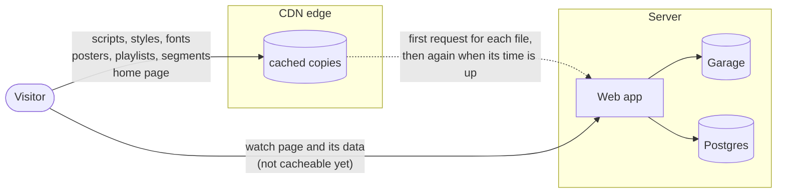

# Scaling a real visit: pages, assets, posters and video

This continues [home-page-scaling.md](home-page-scaling.md), which looked only at
the home page's HTML. Here the whole visit is counted: styles, scripts, fonts,
posters and the video itself.

Like that document, this is a record of an experiment. **No CDN is configured.**

**Update:** the first four improvements listed at the end have since been made.
The measurements in the body were taken before them and are kept as the baseline;
[After the improvements](#after-the-improvements) gives the new figures and says
which statements below no longer hold.

The short version: once video is counted, the HTML barely matters. One viewer
watching in 1080p uses as much of the server's network link as about 70 home
page requests per second, and keeps using it for as long as they watch.

## What a visit downloads

Measured in headless Chromium against the production build, on a development
laptop, with the local catalog of two videos. Sizes are what travelled over the
network, headers included.

### Arriving at the home page

| Resource | Requests | Size | Share |
|---|---|---|---|
| Page HTML | 1 | 6.1 KB | 2% |
| Scripts | 15 | 42.5 KB | 12% |
| Styles | 4 | 5.8 KB | 2% |
| Fonts | 2 | 51.0 KB | 15% |
| Posters | 2 | 242.9 KB | 70% |
| **First visit** | **24** | **348 KB** | |
| **Repeat visit** | 24 | 0.2 KB | |

- **Posters are most of the page.** There are only two here, 36 KB and 207 KB.
  The page grows with the catalog, although posters below the visible area are
  only fetched when scrolled to.
- **A repeat visit is almost free on the network.** Everything except the HTML
  comes from the browser's own cache, and the HTML is answered with "not
  modified". The server still renders the page to produce that answer.

### Opening a video

| Step | Requests | Size |
|---|---|---|
| Player script, loaded on demand | 2 | 148 KB |
| Page data and playlists | 5 | 12.5 KB |
| Video, **before play is pressed** | 24 | 40.3 MB |

The last row is the surprise. As soon as the watch page opens, the player starts
filling its buffer, and on a fast connection it had fetched about 96 seconds of
1080p video, 40 MB, before anyone pressed play. A visitor who opens a video and
leaves still costs 40 MB.

### Watching

After play was pressed the player fetched 21.2 MB over the next 60 seconds, about
2.8 Mbit/s, keeping its buffer roughly a minute and a half ahead.

The stored video for the 10 minute 35 second test film averages:

| Quality | Average bitrate | Per 4-second segment | Whole film |
|---|---|---|---|
| 1080p | 3.43 Mbit/s | 1.71 MB | 272 MB |
| 720p | 1.93 Mbit/s | 0.96 MB | 153 MB |
| 480p | 1.10 Mbit/s | 0.55 MB | 87 MB |
| 360p | 0.75 Mbit/s | 0.37 MB | 59 MB |

## What each kind of request costs the server

Every request below goes to the web app. Static files are read from disk. Posters,
playlists and video segments are different: for each one the web app checks the
database that the video is published, then reads the file from Garage and passes
it through.

Load-tested for 10 seconds each, as fast as possible, on the same laptop, with no
HTTPS and no proxy:

| Resource | Requests per second | Data sent | What was busy |
|---|---|---|---|
| Script file (static) | 28,400 | 193 Mbit/s | web app |
| Playlist | 2,700 | 11 Mbit/s | web app, Garage half a core, Postgres |
| Poster, 36 KB | 1,900 | 568 Mbit/s | web app, Garage half a core, Postgres |
| 360p segment, 0.37 MB | 640 | 1,864 Mbit/s | web app, Garage a full core |
| 1080p segment, 1.5 MB | 205 | 2,400 Mbit/s | web app, Garage most of a core |

Two things stand out:

- **Anything from the bucket is over ten times more expensive than a static
  file**, because of the database check and the round trip to Garage.
- **Video is limited by bytes, not by requests.** The web app moved about
  2.4 Gbit/s of video on one core, more than a typical server link carries, so on
  a real server the network gives out before the CPU does.

## Without a CDN

Assume a 1 Gbit/s link, as in the home page document. The server's real bandwidth
is not known, so these are arithmetic from the measurements above, not tests of
the server.

### New visitors

A first visit to the home page is 348 KB, so the link is full at about **360 new
visitors per second**. The HTML alone would have allowed about 20,000 requests per
second; counting the rest of the page divides that by more than fifty.

### People watching

A viewer fetches one segment every four seconds. What limits the number of
simultaneous viewers is the bitrate:

| If everyone watches in | Viewers that fill 1 Gbit/s |
|---|---|
| 1080p | about 290 |
| 720p | about 520 |
| 480p | about 910 |
| 360p | about 1,330 |

The player lowers quality by itself when a viewer's connection slows, so a
saturated server degrades to lower qualities before it fails outright.

The other resources are not the limit at these numbers. 290 viewers are about 73
segment requests per second, against the 205 measured, and the database check adds
73 small queries per second.

### What that means

On the production server (6 cores, 12 GB, shared, web app limited to 1.5 cores),
the realistic ceiling is **a few hundred simultaneous viewers**, set by the
network. That is far below any of the page-request ceilings. If the site ever gets
busy, video is what runs out first.

## With a CDN

Every response already says whether it may be cached and for how long:

| Resource | Header sent today | A CDN would |
|---|---|---|
| Scripts, styles, fonts | `public, max-age=31536000, immutable` | keep them for a year; their names change when their content does |
| Video segments | `public, max-age=86400` | keep each for a day |
| Posters | `public, max-age=3600` | keep each for an hour |
| Playlists | `public, max-age=60` | keep each for a minute |
| Home page HTML | `public, max-age=0, s-maxage=30, stale-while-revalidate=60` | keep it for 30 seconds |
| Watch page HTML | none | pass every request to the server |
| Watch page data | `private, no-store` | pass every request to the server |
| Admin pages | `private, no-store` | never keep them |



With that in place:

- **Video comes from the CDN.** The server sends each segment to each CDN location
  once a day at most, however many people watch. The few-hundred-viewer ceiling is
  gone.
- **New visitors cost the server almost nothing**: one home page render per 30
  seconds per location, and the assets not at all.
- **What still reaches the server is the watch page**: one small request per video
  opened, with two database queries. That is the remaining ceiling until the
  watch page is made cacheable in the same way the home page was. It was not
  measured; by analogy with the home page it should be a few thousand video opens
  per second.

### What it costs

- **Money, in proportion to video watched.** CDNs that allow video charge by data
  delivered. As an illustration only, at a price in the region of one US cent per
  gigabyte, one full viewing of the test film in 1080p (272 MB) costs about a
  quarter of a cent, and 1,000 people watching at once move about 1.5 TB per hour,
  around 15 dollars per hour. Check current prices; they vary by provider and
  region.
- **Slower takedowns.** A segment a CDN has already fetched stays there for up to
  a day after a video is unpublished or deleted, unless the CDN is told to drop
  it. The playlists expire within a minute, which stops new viewers, but someone
  with the segment addresses could still fetch them.
- **The setup described in the home page document**: a rule to cache pages, a
  hostname for admin uploads that bypasses the CDN, and a look at certificates.

## Side by side

| | Without a CDN | With a CDN |
|---|---|---|
| New visitors per second | about 360 before the link is full | not limited by the server |
| Simultaneous viewers | about 290 in 1080p, up to about 1,330 in 360p | not limited by the server |
| What limits the site | the server's network link | the watch page, at an estimated few thousand opens per second |
| Who sends the video | the server | the CDN |
| Server work per viewer | a segment, a database check and a Garage read every 4 seconds | none once a segment is at the edge |
| Removing a video takes effect | within a minute | within a minute for new viewers; cached segments linger up to a day |
| Running cost | none | grows with hours watched |

## After the improvements

Improvements 1 to 4 from the list below are now in the code. The same visit,
measured the same way:

| | Before | After |
|---|---|---|
| Home page, first visit | 348 KB | 152 KB |
| of which posters | 243 KB | 51 KB |
| of which page HTML | 6.1 KB | 2.0 KB |
| Opening a video, before play is pressed | 40.3 MB | 0.15 MB, none of it video |
| Video kept ready ahead of the playhead | about 96 s | about 30 s |
| Downloaded in the first minute of watching | 61.5 MB | 39.0 MB |
| Watch page for a published video | not cacheable | cacheable for 30 s, like the home page |

Pressing play started the picture moving in 0.6 seconds in the local test, and
dragging the timeline before pressing play works.

What this changes in the analysis above:

- **New visitors without a CDN:** a first visit is 152 KB, so a 1 Gbit/s link is
  full at about 820 new visitors per second, up from about 360.
- **Opening a video is no longer expensive.** A visitor who opens a video and
  leaves costs 150 KB, almost all of it the player script, which the browser then
  keeps.
- **Simultaneous viewers are unchanged.** Someone who keeps watching still needs
  the full bitrate, so the table of viewers per quality stands: about 290 in 1080p.
  Video is still what runs out first.
- **With a CDN, the watch page is no longer the remaining ceiling.** It is now
  cached like the home page, so the rows for "Watch page HTML" and "Watch page
  data" in the header table, the note on the diagram and the "what limits the
  site" row in the comparison describe the earlier state. An admin's preview of
  an unpublished video is still never cached.

## Improvements this points to

The first four are done; the fifth is not. They are listed in the order they were
ranked, by how much they save for the effort.

1. **Do not download video before play is pressed.** *Done.* The player now waits
   for play or a drag of the timeline, and keeps 30 seconds ready. Before, opening
   a video cost up to 40 MB even if nobody watched it.
2. **Make posters smaller.** *Done.* Each video now has two WebP posters: up to
   1280 by 720 for the player and the featured video, and up to 640 by 360 for
   cards and thumbnails. Existing videos are converted once by the worker.
3. **Make the watch page cacheable**, as was done for the home page. *Done* for
   published videos.
4. **Compress the HTML.** *Done.* Pages and page data are compressed on the way
   out: the home page goes from 5.9 KB to 1.6 KB.
5. **Serve media from storage through a CDN directly** (not done), without passing through
   the web app. This removes the database check and the extra hop for every
   segment, but it means deciding how unpublished videos stay private, which the
   web app handles today.

## Reproducing the measurements

Start the production build as described in
[home-page-scaling.md](home-page-scaling.md#reproducing-the-measurements), then:

```bash
# as fast as possible, against any one resource
npx autocannon@8.0.0 -c 100 -w 4 -d 10 http://localhost:5198/media/<video id>/1080p/seg_00010.ts
```

The visit sizes were recorded with Playwright driving Chromium: load the home
page with an empty cache, reload it, open a video, and sum the response sizes by
kind of resource.
