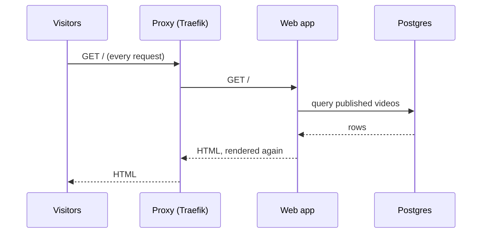
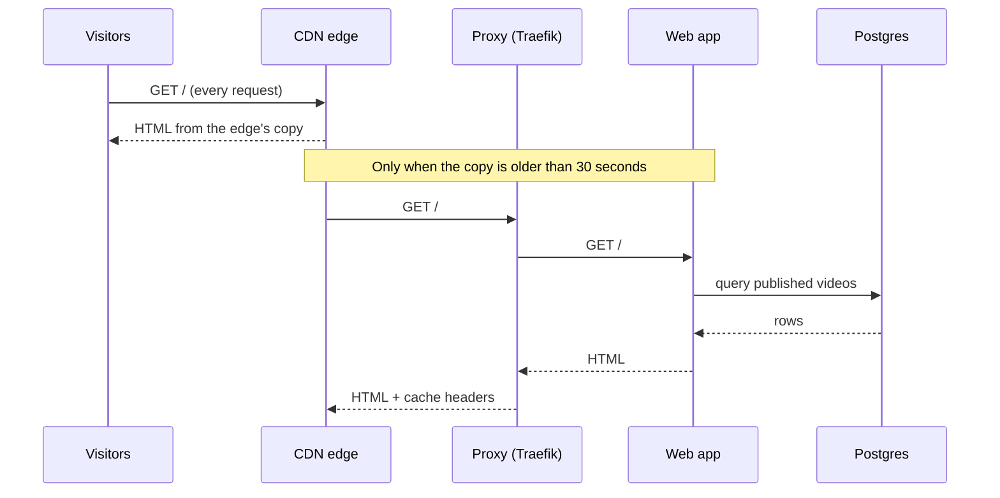

# Scaling the home page: with and without a CDN

This is a record of an experiment, not a description of something that is
deployed. The question was: what happens if the home page starts receiving very
high traffic, up to 100,000 requests per second, and what would a CDN change?

**Scope: the home page's HTML only.** A real visit also loads styles, scripts,
fonts, posters and video. Those are left out on purpose. They matter, and the same
reasoning applies to them, but they were not part of this experiment.

**Status in November 2026:** no CDN is in front of the site. The application has
been prepared for one (see [What is already in the code](#what-is-already-in-the-code)).

## What one home page request costs

Each request to `/` makes the web app:

1. run one database query (the published, ready videos), and
2. render the page to HTML on the server.

The response is 5.9 KB, or about 2 KB if compressed with gzip.

## Measurements

All numbers below were measured on a development laptop (8 cores), against the
local database with two videos, using the production build of the web app.
The load tool was [autocannon](https://github.com/mcollina/autocannon), 10
seconds per test with connections reused: 100 connections for the fixed-rate
test and 200 for the others.

There was **no HTTPS and no proxy** in these tests, and the load came from the
same machine. A real server adds both, so treat every figure as an upper bound
for hardware of that class.

| Test | Requests per second | Slowest 1% | Data sent | Web app CPU |
|---|---|---|---|---|
| As built, held at 1,000 req/s | 1,000 | 32 ms | 49 Mbit/s | a quarter of one core |
| As built, as fast as possible | 4,900 | 55 ms | 239 Mbit/s | one core, saturated |
| As built, pinned to one core | 3,300 | 162 ms | 160 Mbit/s | one core, saturated |
| Experimental in-memory page cache | 34,700 | 10 ms | 1,691 Mbit/s | one core, saturated |
| Experimental cache, pinned to one core | 28,900 | 24 ms | 1,408 Mbit/s | one core, saturated |

During the uncached tests the database was not the limit: the web app used a full
core while Postgres was barely working.

The "experimental in-memory page cache" kept the rendered page in the web app's
memory for 30 seconds. It was written only to take this measurement and is **not
in the codebase**.

## Without a CDN

Every request travels to the one server and is answered there.



As traffic rises, three things give out, in this order:

| Order | What gives out | Roughly when | Can it be fixed on the server? |
|---|---|---|---|
| 1 | Web app CPU, rendering the page | about 5,000 req/s per core (measured) | Yes: cache the rendered page in memory |
| 2 | Database, one query per request | tens of thousands of queries per second (not measured) | Yes: the same cache removes it |
| 3 | Network link | about 20,000 req/s fills 1 Gbit/s at 5.9 KB per page | No |

The third row is arithmetic, and it assumes a 1 Gbit/s link; the server's real
bandwidth is not known. Compression would stretch it to roughly 50,000, at a cost
in CPU.

### What that means for the production server

The server has 6 cores and 12 GB of memory, shared with other projects, and the
web app container is limited to 1.5 cores.

| Setup | Expected home page capacity | Basis |
|---|---|---|
| As deployed | a few thousand requests per second | measured per-core rate, then the 1.5-core limit |
| With an in-memory page cache | roughly 10,000 to 20,000 | estimate: the measured 29,000 to 35,000, reduced for the proxy, HTTPS and slower shared cores |
| Beyond that | not reachable | the network link is full |

The second row is an estimate, not a measurement. Three things the tests did not
include all push it down: the proxy handles and encrypts every request on the
same cores; real visitors each open a new encrypted connection, which costs far
more than serving a cached page; and a VPS core is usually slower than a laptop
core.

**At 100,000 requests per second, this setup fails on every count**: about 18
cores of rendering, 100,000 database queries per second and about 4.7 Gbit/s of
HTML, against 1.5 cores, one small Postgres and one network link.

## With a CDN

A CDN is a shared HTTP cache run on many servers around the world. It keeps one
copy of the page per location and answers visitors from that copy.



The server now renders the page about **once every 30 seconds per CDN location**,
whatever the traffic. 10 requests per second and 100,000 look the same to it. The
bytes are sent from the CDN's network, so the server's link is no longer the
limit.

### How the page tells the CDN what to do

The home page sends this header:

```
cache-control: public, max-age=0, s-maxage=30, stale-while-revalidate=60
```

| Part | Meaning |
|---|---|
| `public` | Any cache may store this response |
| `max-age=0` | Browsers must check back every time, so a visitor's own browser never shows an old page |
| `s-maxage=30` | A shared cache, such as a CDN, may reuse its copy for 30 seconds |
| `stale-while-revalidate=60` | For 60 seconds after that, it may still hand out the old copy while it fetches a new one in the background |

### What it costs

- **Freshness.** A video that was just published, unpublished, renamed or deleted
  can take up to 30 seconds to change on the home page. At a location with very
  little traffic it can be up to 90 seconds, because of the grace period above.
  The alternative is a long cache time plus telling the CDN to drop its copy
  whenever the catalog changes; that is immediate but ties the app to one CDN's
  API.
- **A dependency and possibly a bill.** The site then relies on a third party.
  Some CDNs are free for ordinary pages; others charge by data delivered.
- **Setup work**, listed below.

### What setting one up would involve

None of this has been done.

- **Choose how it attaches.** Either the CDN takes over DNS for the whole domain
  (the Cloudflare model), which also moves every other project's records, or it
  serves a single hostname (Bunny, CloudFront, Fastly and similar) and DNS stays
  where it is. The domain's DNS is at Porkbun today.
- **Turn on caching of pages.** Most CDNs cache only images, scripts and styles
  by default. A rule is needed to cache HTML and follow the header above.
- **Keep uploads out of it.** Admin uploads go through the same hostname, and
  CDNs limit the size of an upload. The admin area would need a hostname that
  bypasses the CDN.
- **Check certificates.** The server obtains its HTTPS certificates
  automatically; with a proxy in front, how it proves ownership of the domain may
  need adjusting.
- **Read the video terms.** Outside the scope of this document, but some CDN
  plans restrict serving video through the regular CDN.

## Side by side

| | Without a CDN | With a CDN |
|---|---|---|
| Who answers a home page request | the server, every time | the CDN; the server about once per 30 s per location |
| Renders per second at 100,000 req/s | 100,000 | well under 1 |
| Database queries at 100,000 req/s | 100,000 | well under 1 |
| Limited by the server's network link | yes, around 20,000 req/s | no |
| Realistic ceiling on this server | a few thousand req/s; 10,000 to 20,000 with an in-memory cache (estimate) | set by the CDN, not the server |
| How quickly a change appears | immediately | within 30 s, up to 90 s at a quiet location |
| Distance to the visitor | wherever the server is | the nearest CDN location |
| Extra moving parts | none | a third-party service, a caching rule, an upload bypass |
| Cost | none | none to modest for pages, depending on the CDN |

## What is already in the code

Two changes made the home page safe for a shared cache. They are harmless without
one: browsers still fetch the page from the server every time.

- **The page is the same for every visitor.** The header's admin link used to be
  added by the server for a signed-in admin, which made the HTML differ by who
  asked. A cache could then have served the admin's version to a visitor. The
  link is now added in the browser, from a hint cookie set at sign-in. That
  cookie grants nothing; `/admin` still checks the real session.
- **The page sends the cache header** shown above, and admin pages send
  `private, no-store` so that no cache ever keeps one.

Not in the code: an in-memory page cache, and anything specific to a CDN.

## Reproducing the measurements

```bash
pnpm build
cd webapp
PORT=5198 ORIGIN=http://localhost:5198 node --env-file=../.env build &

# as fast as possible
npx autocannon@8.0.0 -c 200 -w 4 -d 10 http://localhost:5198/

# held at 1,000 requests per second
npx autocannon@8.0.0 -c 100 -R 1000 -d 10 http://localhost:5198/
```

To repeat the single-core rows, start the server with `taskset -c 0` in front of
`node`.
